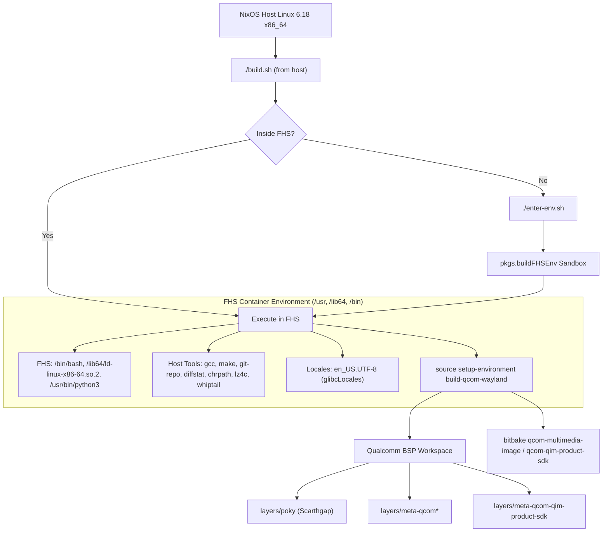

# Qualcomm Intelligent Multimedia SDK (QIM SDK) Build Environment on NixOS

This repository provides an automated, reproducible **NixOS build environment** for [meta-qcom-qim-product-sdk](https://github.com/gngram/meta-qcom-qim-product-sdk) and the Qualcomm Linux Yocto Project BSP (Scarthgap).

---

## 1. Quickstart (TL;DR)

### A. Clone the Repository (with Submodules)
```bash
git clone --recursive https://github.com/gngram/nixos-devenv-qcom-qim-products.git
cd nixos-devenv-qcom-qim-products
```
*(If cloned without `--recursive`, run `make submodules` or `git submodule update --init --recursive`)*

### B. Preflight System Health Check
Verify your host machine has adequate disk space (100+ GB), memory, user namespaces, and tools:
```bash
make check   # or ./check-env.sh
```

### C. Initial Setup (One-Time)
Initialize Qualcomm's Yocto Scarthgap BSP layers into `workspace/`:
```bash
make init    # or ./init-workspace.sh
```
*(This initializes `repo`, synchronizes Qualcomm's layers into `workspace/`, and links your local `meta-qcom-qim-product-sdk`.)*

### D. Daily Building
You can run builds directly from your terminal (or via Make):

```bash
# Build standalone QIM SDK artifacts
make build   # or ./build.sh qcom-qim-product-sdk

# Build the complete flashable multimedia system image
make image   # or ./build.sh qcom-multimedia-image

# Or launch an interactive shell inside the Yocto container
make shell   # or ./enter-env.sh
```

> [!NOTE]
> **Do I need to run `enter-env.sh` first?**  
> **No.** `./build.sh` automatically detects if you are on the host and transparently launches inside the FHS container.


---

## 2. Architectural Overview

The Qualcomm Intelligent Multimedia SDK and Yocto Project require a standard Linux Filesystem Hierarchy Standard (FHS) layout, canonical paths (`/bin/bash`, `/usr/bin/env`), standard dynamic linkers (`/lib64/ld-linux-x86-64.so.2`), GCC/Make/Python3 host toolchains, and strict UTF-8 locales.

NixOS organizes software into immutable `/nix/store` derivations without global `/usr/bin` or `/lib64`. To achieve 100% Yocto compatibility without modifying your host system or requiring root/Docker daemon privileges:

- **Bubblewrap FHS Sandbox (`buildFHSEnv`)**: Transparently constructs an unprivileged user namespace container with canonical `/bin`, `/lib`, `/lib64`, and `/usr` hierarchies populated with all required Yocto host tools.
- **Nix Flake & Classic Shell**: Supports modern Nix Flakes (`flake.nix`), classic `nix-shell` (`shell.nix`), and `default.nix`.
- **Direnv Coexistence**: `.envrc` safely loads host development tools outside the sandbox, while automatically disabling itself inside the FHS container to prevent namespace recursion and `PATH` shadowing.
- **Auto-Chroot Execution**: Scripts ([`build.sh`](file:///home/gangaram/playground/qualcomm/build.sh), [`init-workspace.sh`](file:///home/gangaram/playground/qualcomm/init-workspace.sh)) automatically inspect the environment and re-launch into the FHS container when invoked from the host.



---

## 3. Repository & Workspace Layout

```
~/playground/qualcomm/
├── build.sh                   # Main build runner (auto-enters FHS container)
├── enter-env.sh               # Enters interactive FHS bash shell
├── init-workspace.sh          # One-time workspace synchronization script
├── default.nix                # Core buildFHSEnv definition & dependencies
├── flake.nix / flake.lock     # Flake definitions (devShells.default, packages.fhs)
├── shell.nix                  # Classic nix-shell entry point
├── .envrc                     # Direnv configuration (FHS-guarded)
├── README.md                  # This documentation
├── meta-qcom-qim-product-sdk/ # Working git repository for the QIM SDK layer
└── workspace/                 # Synced Qualcomm Yocto BSP release
    ├── layers/                # Poky, meta-qcom, meta-openembedded, etc.
    │   └── meta-qcom-qim-product-sdk -> ../../meta-qcom-qim-product-sdk
    ├── build-qcom-wayland/    # Build output directory (conf, tmp-glibc, cache)
    │   └── conf/              # bblayers.conf, local.conf, auto.conf
    └── setup-environment      # Qualcomm environment configuration script
```

---

## 4. Workflows & Command Reference

### A. Automatic Builds (Recommended)
You can pass any target and BitBake arguments directly to `./build.sh`:

```bash
# Build full image
./build.sh qcom-multimedia-image

# Build QIM SDK artifacts only
./build.sh qcom-qim-product-sdk

# Pass BitBake flags (e.g. continue on error, run specific task, dry run)
./build.sh qcom-multimedia-image -k
./build.sh qcom-qim-product-sdk -c compile -f
./build.sh qcom-multimedia-image -n
```

**Customizing Target Platform & Distro:**
```bash
# Default machine: qcs6490-rb3gen2-vision-kit, default distro: qcom-wayland
MACHINE=qcs6490-rb3gen2-vision-kit DISTRO=qcom-wayland ./build.sh qcom-multimedia-image
```

---

### B. Interactive Shell Inside the FHS Container
Use [`./enter-env.sh`](file:///home/gangaram/playground/qualcomm/enter-env.sh) when you want an interactive terminal to inspect recipes, run `devtool`, or use BitBake utilities directly:

```bash
# 1. Enter the FHS sandbox
./enter-env.sh

# 2. Inside the container, navigate to workspace and source environment
cd workspace
export SHELL=/bin/bash
export EXTRALAYERS="meta-qcom-qim-product-sdk"
MACHINE=qcs6490-rb3gen2-vision-kit DISTRO=qcom-wayland source setup-environment build-qcom-wayland

# 3. Run interactive commands
bitbake-layers show-layers
bitbake -e qcom-qim-product-sdk | grep ^S=
devtool --help

# 4. Exit back to host NixOS
exit
```

---

### C. Workspace Initialization Options
[`init-workspace.sh`](file:///home/gangaram/playground/qualcomm/init-workspace.sh) supports the following flags:

```bash
# View help
./init-workspace.sh --help

# Sync a specific Qualcomm release manifest
./init-workspace.sh --manifest qcom-6.6.142-QLI.1.9.1-Ver.1.0_qim-product-sdk-2.5.0.xml

# Custom parallel sync threads
./init-workspace.sh --jobs 16

# Dry-run (initialize repo manifest without downloading source layers)
./init-workspace.sh --dry-run
```

---

## 5. Output Artifacts

Once a build finishes, artifacts are located in:

- **Flashable System Images**:  
  `workspace/build-qcom-wayland/tmp-glibc/deploy/images/qcm6490/qcom-multimedia-image`
- **QIM SDK Artifacts**:  
  `workspace/build-qcom-wayland/tmp-glibc/deploy/qim_prod_sdk_artifacts`
- **Standard SDK Installer**:  
  `workspace/build-qcom-wayland/tmp-glibc/deploy/sdk/*.sh`

---

## 6. Build Optimization & Caching

To speed up rebuilds across projects and prevent redownloading sources:

In `workspace/build-qcom-wayland/conf/local.conf`:
```bitbake
# Shared download and sstate directories
DL_DIR ?= "${TOPDIR}/../shared-cache/downloads"
SSTATE_DIR ?= "${TOPDIR}/../shared-cache/sstate-cache"

# Build parallelism (set according to CPU cores)
BB_NUMBER_THREADS ?= "12"
PARALLEL_MAKE ?= "-j 12"
```

---

## 7. Troubleshooting & FAQ

### `python3: command not found` or `bitbake: command not found`
* **Cause**: Sourcing `setup-environment` on the bare NixOS host instead of inside the FHS container.
* **Fix**: Run `./build.sh` (which auto-launches the FHS container) or run `./enter-env.sh` first.

### Direnv / `bwrap: nesting depth exceeded (ENOSPC)`
* **Cause**: Host `direnv` recursively executing bubblewrap inside child shells.
* **Fix**: Already solved. [`.envrc`](file:///home/gangaram/playground/qualcomm/.envrc) contains a circuit-breaker that exits immediately if `/usr/bin/python3` or `IN_YOCTO_FHS` is detected.

### CodeLinaro 503 / Git Fetch Failures
* **Cause**: Qualcomm's git mirrors (`git.codelinaro.org`) occasionally experience transient maintenance.
* **Fix**: Re-run the command; BitBake caches already-fetched packages and resumes from the last completed task.

### `m4-native` / `configure: error: cannot run C compiled programs` (`stack smashing detected`)
* **Cause**: Yocto's `uninative` downloads an external dynamic linker (`ld-linux` 2.43) to allow cross-distro sstate caching. In NixOS FHS, mixing this external linker with the hermetic Nixpkgs host glibc (2.42) causes TLS canary divergence and immediate stack protector aborts (`__stack_chk_fail`).
* **Fix**: Disable uninative since the Nix FHS environment is already 100% reproducible:
  ```bitbake
  INHERIT:remove = "uninative"
  ```
  `./build.sh` automatically ensures this override is present in `conf/local.conf`.

### `CompressionError: Process died with -6` in `bb.compress.zstd.open`
* **Cause**: `zstd-native` was compiled before `uninative` was removed, retaining the old uninative interpreter header. When a recipe populates `zstd` into its sysroot, executing `zstd` triggers SIGABRT (`-6` in Python) due to stack canary divergence.
* **Fix**: Remove stale uninative caches and rebuild `zstd-native` and `unzip-native`:
  ```bash
  rm -rf workspace/build-qcom-wayland/tmp-glibc/sysroots-uninative workspace/sstate-cache/universal
  ./enter-env.sh "cd workspace && source setup-environment build-qcom-wayland && bitbake -c cleansstate zstd-native unzip-native"
  ```

### `shadow-native: configure: error: crypt() not found`
* **Cause**: BitBake defaults to `virtual/crypt-native` in `ASSUME_PROVIDED`, expecting the host to provide `crypt()`. BitBake sanitizes host library paths during native recipe builds, and Nixpkgs' GCC toolchain wrapper does not implicitly link against `/usr/lib` without explicit flags. As a result, `ld` cannot locate `libcrypt.so`.
* **Fix**: Tell BitBake to compile `libxcrypt-native` hermetically inside the Yocto sysroot rather than assuming host availability:
  ```bitbake
  ASSUME_PROVIDED:remove = "virtual/crypt-native"
  ```
  `./build.sh` automatically ensures this override is present in `conf/local.conf`.


